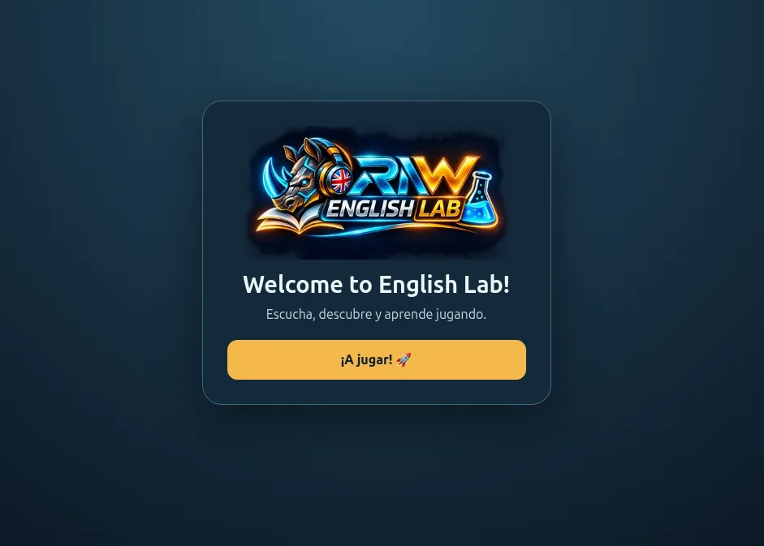
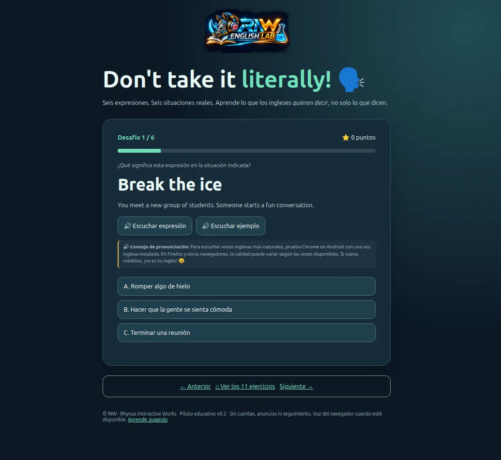

# 🦏 RIW · ENGLISH LAB

### Escucha, descubre y aprende jugando.

## 🔬 ¿Qué es RIW English Lab?

**RIW English Lab** es un laboratorio educativo interactivo creado por **Rhynus Interactive Works (RIW)** para explorar el inglés mediante retos breves, situaciones cotidianas y aprendizaje activo.

Aquí no se trata solo de memorizar palabras. El participante escucha, interpreta, decide y descubre por qué una expresión significa algo distinto de su traducción literal. La actividad **Don't take it literally!** presenta seis expresiones idiomáticas inglesas (*idioms*) en seis situaciones reales, con ejemplos y opciones de respuesta.

El laboratorio reúne **11 ejercicios** en su catálogo, con navegación entre actividades. Su objetivo es ayudar a practicar inglés de manera accesible, amena y progresiva, sin necesidad de crear una cuenta.

### ✨ ¿Qué puedes hacer?

- 🧩 Resolver desafíos y comprobar lo aprendido.
- 🔊 Escuchar expresiones y ejemplos cuando el navegador disponga de voces compatibles.
- ⭐ Seguir la puntuación y el progreso en las actividades que lo incorporan.
- 🗣️ Interpretar expresiones inglesas en situaciones cotidianas.
- 📱 Aprender desde ordenador o móvil.
- 🔓 Acceder libremente a la experiencia pública.

## 🖼️ Capturas reales

**Pantalla de bienvenida**

**Don't take it literally! · Break the ice**

## 🚀 ¡Pruébalo y dinos qué te parece!

### **[👉 Abrir RIW English Lab](https://rhynocerus.github.io/riw-english-lab/)**

Abre el laboratorio, pulsa **¡A jugar!** y explora sus ejercicios. Si encuentras un error o tienes una sugerencia, puedes dejarla en [Issues del repositorio](https://github.com/rhynocerus/riw-english-lab/issues).

## 🛠️ Tecnologías

La experiencia se desarrolla para navegadores web mediante **HTML, CSS y JavaScript** y se publica en **GitHub Pages**. Emplea imágenes optimizadas para web. La reproducción de voz depende del navegador, las voces instaladas y la compatibilidad del dispositivo.

## 📜 Política editorial y licencias

**Rhynus Interactive Works (RIW)** promueve el aprendizaje abierto, la experimentación responsable y el intercambio de conocimientos.

- **Publicación autorizada.** No publicar materiales, modificaciones o recursos de terceros sin autorización.
- **Identidad corporativa.** Los logotipos, emblemas, nombres y signos distintivos de RIW y RIW English Lab mantienen su identidad original y **quedan excluidos de las licencias abiertas generales**. Su uso como marca requiere autorización.
- **Privacidad y seguridad.** No incluir contraseñas, tokens, claves, datos personales ni información privada.
- **Recursos de terceros.** Respetar sus licencias y derechos originales. Su inclusión en el proyecto no cambia esos derechos.
- **Colaboración.** Se agradecen propuestas y correcciones respetuosas con la finalidad educativa y la identidad RIW.

### Licencia propuesta para contenidos educativos

**Propuesta pendiente de aprobación específica:** aplicar [Creative Commons Atribución-CompartirIgual 4.0 Internacional](https://creativecommons.org/licenses/by-sa/4.0/deed.es) a los **textos y explicaciones educativos originales expresamente identificados**, excluyendo código, logotipos, marcas y materiales de terceros.

**Código fuente:** el repositorio no dispone actualmente de un archivo `LICENSE` en la raíz. Antes de asignar una licencia de software se deberá elegirla expresamente.

> La insignia CC BY-SA indica una **propuesta**, no una licencia ya concedida a todos los archivos del repositorio.

## 🌱 Rhynus Interactive Works

**RIW · Aprender, experimentar y compartir conocimiento.**

[🌐 RIW](https://rhynus-interactive-works.rhynus.chatgpt.site/) · [🎮 English Lab](https://rhynocerus.github.io/riw-english-lab/) · [💻 GitHub](https://github.com/rhynocerus/riw-english-lab)
